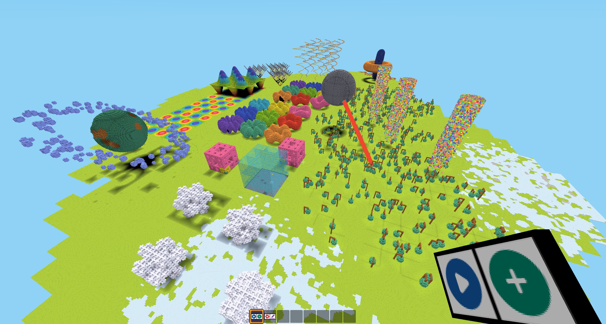

CodeBlock
=========================

[](https://github.com/gigaturbo/codeblock/actions/workflows/ci.yml)

[](https://content.luanti.org/packages/giga-turbo/codeblock/)

**CodeBlock allows to use `lua` code in Luanti to build anything you want**

A drone you program in Lua, an in-game editor, a sandbox and a documented API. It brings its own blocks: 3930 colours as solid blocks, and 35 named colours each as a brick, a glass and a lamp. It depends only on [vector3](https://content.luanti.org/packages/giga-turbo/vector3/). The [Codecube](https://content.luanti.org/packages/giga-turbo/codecube/) game bundles it with a flat world and settings made for it, which is the easiest way to try it. The Lua and block reference is at [`doc/api.md`](https://github.com/gigaturbo/codeblock/blob/master/doc/api.md#lua-api).

**License:** AGPLv3   
**Credits:** inspired by [Gnancraft](http://gnancraft.net/), [ComputerCraft](http://www.computercraft.info/), [Visual Bots](https://content.luanti.org/packages/Nigel/vbots/), [TurtleMiner](https://content.luanti.org/packages/BirgitLachner/turtleminer/), [basic_robot](https://github.com/ac-minetest/basic_robot)



## Quick start

The game shows these steps when you join, until you tick *Do not show again*.
The **?** button in the editor and `/codeblock help` bring them back.

### Run your first program

1. Create an empty (flat) world, enable the `codeblock` mod and its one dependency `vector3`
2. Enable creative mode and start the game
3. Get the four drone tools: run the `/codeblock tools` command
4. Click a block with the  **Placer** to place the drone, choose `stairs.lua`, then click with the  **Runner** to start the drone

### Write your first program

1. Click with the  **Editor** to open the `lua` editor
2. Create a new file with the `New file` field and write some code on the main window
3. Click the green run button to save the file, give it to the drone and close the editor
4. Click a block with the  **Placer**, then run the code by clicking with the  **Runner**
5. Read the [Lua API](https://github.com/gigaturbo/codeblock/blob/master/doc/api.md#lua-api) in `doc/api.md` to know which commands and blocks you can use

### Watch and steer a running program

- While your program runs, a **HUD** in the top-right corner names the file, says
  whether it is running or paused, and shows the limits of the drone. Untick *Show the drone HUD* on the editor's **Settings** panel to turn it
  off or set `codeblock_drone_hud = false` for the server's default.
- **Click with the  Status tool** to open your drone's panel, whatever it
  is doing: every limit with what the run has spent beside it, a line saying what
  each one means, and buttons to **pause**/**resume** and **stop**
  the drone.

### Explore and tweak

- More built-in examples are available, just open the editor and choose an example to run
- User `codelevel` can be adjusted to tweak drone performance and capacities, see [permissions](https://github.com/gigaturbo/codeblock/blob/master/doc/api.md#codelevel) and [chat commands](https://github.com/gigaturbo/codeblock/blob/master/doc/api.md#chat-commands)

## For game authors

Your game can add a block category of its own. Call this from a mod that names
`codeblock` in its `depends`, at load time:

```lua
codeblock.register_blocks('wool', {
    red = 'wool:red',
    blue = 'wool:blue'
})
```

`wool.red` is then a block a player's program can place, listed in the editor
beside the mod's own bricks, glass and lamps. The keys are the names a program
spells; the values are itemstrings your game has registered.

Registrations are queued at the call and checked once every mod has loaded, so a
node belonging to a mod that loads later is still accepted. A name that collides
with the existing API, cannot be a table key, or names no node is logged and
dropped — never raised, so a typo in your game cannot stop the server.

A player sees the mod's quick start when they join. A game that teaches its own
way in turns it off with `codeblock_quickstart = false`; the editor's **?**
button and `/codeblock help` still show it.
